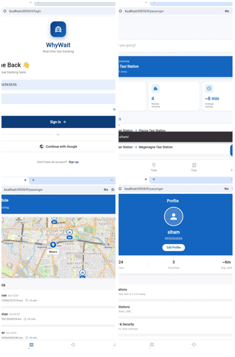
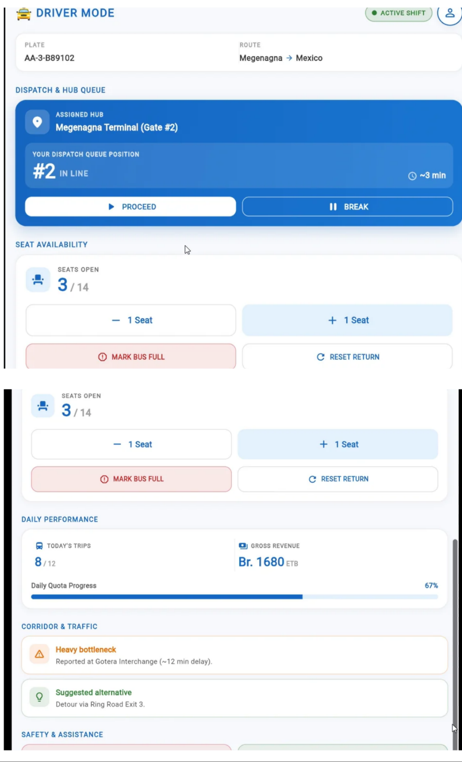
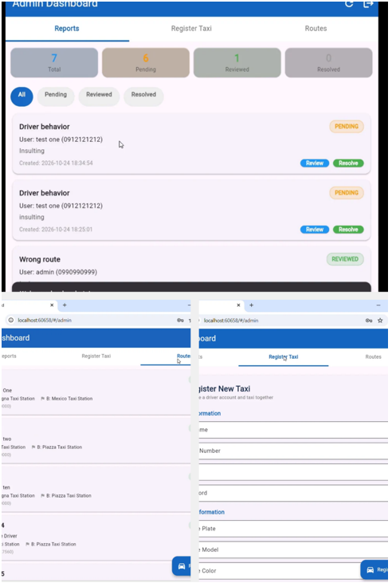
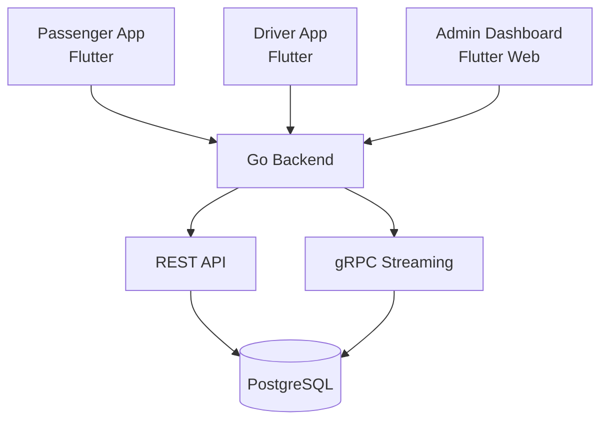

# 🚕 WhyWait -- Real-Time Shared Taxi Tracking Platform


WhyWait is a real-time shared taxi tracking platform designed to make
urban transportation more predictable, transparent, and efficient.

------------------------------------------------------------------------

## 🎥 Project Demo & Explanation

Watch our project presentation and explanation:

[▶ Watch WhyWait Project
Explanation](https://drive.google.com/file/d/10IuAi29xDkng820UzyWseNtZ0pxn8FZ-/view?usp=sharing)

------------------------------------------------------------------------

## 📖 Overview

WhyWait connects passengers with nearby shared taxis through a Flutter
application. It helps passengers track taxis, view estimated arrival
times, plan routes, and access trip information. Drivers use the
platform to manage their work and assigned routes, while administrators
manage users, drivers, taxis, terminals, and reports.

The platform uses Flutter for its frontend, Go for its backend, and
PostgreSQL for data storage. It uses REST APIs for application
operations and gRPC streaming for real-time updates.
## 📸 Screenshots

### Passenger App


### Driver App


### Admin Dashboard


## 🎯 Problem & Solution

Traditional shared taxi services can involve unpredictable waiting
times, limited visibility into vehicle locations, inefficient
dispatching, route deviations, and difficulty keeping digital trip
records or resolving incidents.

WhyWait addresses these challenges by providing:

-   Live taxi location tracking and estimated arrival information.
-   Route and corridor information for more predictable journeys.
-   Route recommendations to help passengers plan trips.
-   Digital trip records and fare information.
-   Driver and taxi management tools.
-   Incident reporting and an administrative workflow for handling
    reports.

------------------------------------------------------------------------

## 👤 System Users

  -----------------------------------------------------------------------
  User                    Description             Main Activities
  ----------------------- ----------------------- -----------------------
  Passenger               A person looking for    Find and track taxis,
                          shared taxi             plan routes, view trip
                          transportation.         history, and report
                                                  incidents.

  Driver                  A driver operating a    View assigned routes,
                          registered taxi.        manage available seats
                                                  and availability, and
                                                  access trip and
                                                  performance
                                                  information.

  Admin                   A system administrator. Manage users, drivers,
                                                  taxis, terminals,
                                                  routes, and passenger
                                                  reports.
  -----------------------------------------------------------------------

------------------------------------------------------------------------

## ✨ Key Features

### Backend (Go + PostgreSQL)

-   [x] Secure registration and login using JWT authentication and
    bcrypt password hashing.
-   [x] PostgreSQL storage for user profiles, trip history, driver
    information, terminals, routes, and reports.
-   [x] RESTful API organized across domain packages.
-   [x] gRPC streaming for real-time taxi positions and trip updates.
-   [x] Role-based access for passengers, drivers, and administrators.
-   [x] User management and driver approval workflow.
-   [x] Terminal and route management.
-   [x] Driver route assignment.
-   [x] Trip records, fares, and vehicle details.
-   [x] Passenger report routing to the administrative queue.
-   [x] Taxi simulator for demonstration and testing.

### Passenger Application (Flutter)

-   [x] Login and registration with client-side validation and error
    handling.
-   [x] Home dashboard with search, station information, summary
    statistics, and popular routes.
-   [x] Trip history with spending and time-saved analytics.
-   [x] Live tracking with an interactive OpenStreetMap, taxi markers,
    estimated arrival times, and map controls.
-   [x] Route recommendations and route planning with fare and time
    estimates.
-   [x] Trip details and journey breakdowns.
-   [x] Incident reporting with multiple categories.
-   [x] Profile, settings, and sign-out.
-   [x] Loading, error, and empty states across data screens.

### Driver Application (Flutter)

-   [x] Driver home dashboard with shift information, dispatch queue,
    vehicle details, and assigned route.
-   [x] Seat counter for managing available seats and marking a taxi as
    full.
-   [x] Daily performance information, including completed trips and
    revenue.
-   [x] Traffic alerts for corridor congestion.
-   [x] Safety actions, including incident reporting and dispatch
    contact.
-   [x] Assigned route visibility and route-adherence warnings.

### Admin Dashboard (Flutter Web)

-   [x] Dashboard overview of users, active taxis, and pending reports.
-   [x] Driver approval and management.
-   [x] Driver assignment to terminals and routes.
-   [x] Passenger report review and resolution workflow.
-   [x] Terminal management, including GPS coordinates.
-   [x] Taxi registration and management.
-   [x] User management and role administration.

> **Feature status:** The passenger, driver, admin, and backend
> components are substantially implemented. Deployment is the remaining
> major project milestone. Update individual checkboxes if any listed
> feature is not yet complete.

------------------------------------------------------------------------

## 🛠️ Technology Stack

  Category             Technology
  -------------------- ----------------------------------------------------
  Mobile Application   Flutter, Dart
  Web Application      Flutter Web
  Backend              Go (Golang)
  Database             PostgreSQL
  API Communication    REST API, gRPC
  Authentication       JWT, bcrypt
  Maps & Location      OpenStreetMap
  Version Control      Git, GitHub
  Deployment           Render (backend), Vercel (frontend) -- in progress

------------------------------------------------------------------------

## 🏗️ System Architecture

WhyWait uses a client-server architecture. The passenger and driver
Flutter applications, together with the Flutter Web admin dashboard,
communicate with the Go backend. PostgreSQL stores the application's
persistent data. REST handles standard application operations, while
gRPC supports real-time streaming.



------------------------------------------------------------------------

## 📊 Project Progress

  Component                         Status
  --------------------------------- ----------------
  Backend (Go + PostgreSQL)         ✅ Complete
  Passenger Application (Flutter)   ✅ Complete
  Driver Application (Flutter)      ✅ Complete
  Admin Dashboard (Flutter Web)     ✅ Complete
  Deployment                        🟡 In Progress

------------------------------------------------------------------------

## 🚀 Getting Started

### Prerequisites

Install the tools required to run the project:

-   Git
-   Flutter SDK
-   Go
-   PostgreSQL

### 1. Clone the repository

``` bash
git clone <repository-url>
cd <repository-folder>
```

### 2. Configure the backend

-   Create the PostgreSQL database.
-   Configure the required environment variables, including database
    connection details and authentication settings.
-   Follow the backend directory's instructions for database setup and
    migrations, if applicable.

### 3. Start the backend

From the backend directory, install or download the required Go
dependencies and run the application using the instructions provided in
that directory.

### 4. Start a Flutter application

From the relevant passenger, driver, or admin application directory:

``` bash
flutter pub get
flutter run
```

> Replace the repository URL, folder names, and commands above with the
> exact paths and setup commands used in your repository. Do not commit
> secret environment files or credentials.

------------------------------------------------------------------------

## 🧪 Testing

The project has been tested across backend and application workflows.
Add or link the specific test cases, tools, and latest results here so
that this section reflects tests actually run against the current
implementation.

Examples of useful evidence to include:

-   Registration and login tests.
-   Authentication and protected-route tests.
-   Database create/read/update operations.
-   Passenger, driver, and admin workflow tests.
-   Real-time location and trip-update tests.

------------------------------------------------------------------------

## 👥 Project Team

| Name | CTC Number | Classroom | Role |
|---|---|---|---|
| Surafel Yihun | CTC-10004-26 | 3006 | Backend Developer |
| Wengelle Yohannes | CTC-5554-26 | 3006 | Backend Developer |
| Victory Bedru | CTC-4461-26 | 3006 | Frontend Developer |
| Sabah Fuad | CTC-1156-26 | 3006 | Frontend Developer |
| Siham Baharu | CTC-6989-26 | 3006 | Database |
------------------------------------------------------------------------

## 🚧 Remaining Work

-   Complete deployment of the backend and frontend.
-   Configure production environment variables and service connections.
-   Verify the deployed applications and end-to-end workflows.

------------------------------------------------------------------------

**WhyWait -- Making shared transportation more predictable, transparent,
and efficient.** 🚕
