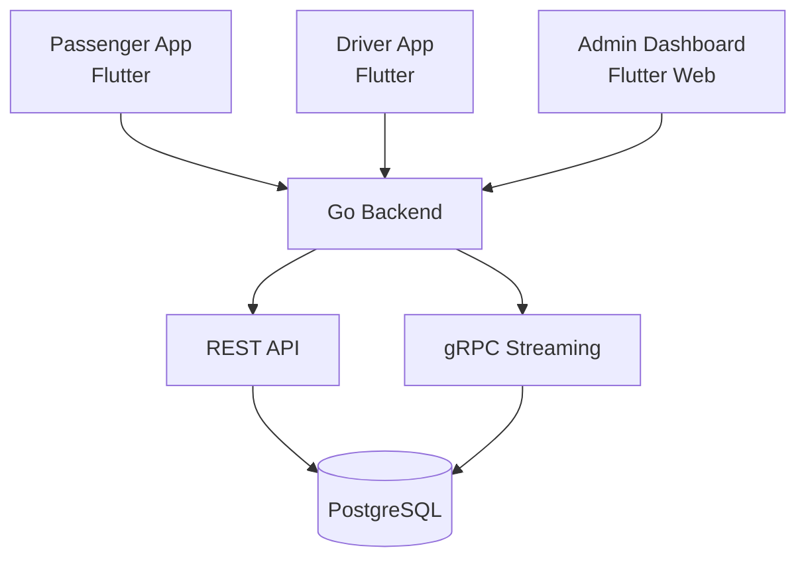

# 🚕 WhyWait – Real-Time Shared Taxi Tracking Platform


---

## 🎥 Project Demo & Explanation

Watch our project presentation and explanation:

[▶ Watch WhyWait Project Explanation](https://drive.google.com/file/d/10IuAi29xDkng820UzyWseNtZ0pxn8FZ-/view?usp=sharing)

---

## 📖 Project Overview

**WhyWait** is a real-time shared taxi tracking platform designed to make urban transportation more predictable, transparent, and efficient.

The platform connects passengers with nearby taxis through a Flutter mobile application, providing live vehicle tracking, estimated arrival times, route recommendations, and trip information. It also provides drivers with route and dispatch management features, while administrators oversee drivers, terminals, routes, and passenger reports.

Built with Flutter, Go, and PostgreSQL, WhyWait aims to improve the shared taxi experience for both passengers and drivers.

---

## 🎯 The Problem & Our Solution

Traditional shared taxi services often face several challenges:

- **Unpredictable waiting times:** Passengers have limited information about approaching taxis and their arrival times.
- **Lack of real-time visibility:** Passengers cannot easily track nearby vehicles.
- **Route deviations:** Drivers may leave their assigned routes, making transportation less predictable.
- **Inefficient route planning:** Passengers lack guidance on the fastest routes and connecting corridors.
- **Safety and accountability concerns:** Limited verification, trip records, and reporting mechanisms make resolving incidents difficult.

### Our Solution

WhyWait addresses these challenges through:

- Real-time taxi location tracking and estimated arrival times.
- Assigned driver routes and corridor management.
- Shortest-path route recommendations for passengers.
- Digital trip records and fare information.
- Direct incident reporting with an administrative resolution workflow.

---

## 📱 Application Preview

<!-- Add your application screenshots here -->

### Passenger Application
<!-- Add passenger home screen and live tracking screenshots -->

### Driver Application
<!-- Add driver dashboard and seat management screenshots -->

### Admin Dashboard
<!-- Add admin dashboard screenshots -->

---

## ✨ Key Features

### 1. Backend (Go + PostgreSQL)

- [x] **Secure Authentication** – Registration, login, JWT-based sessions, and bcrypt password hashing.
- [x] **PostgreSQL Database** – Stores user profiles, trip history, driver information, terminals, routes, and reports.
- [x] **RESTful API** – Go backend with well-defined endpoints across eight domain packages.
- [x] **gRPC API** – Real-time streaming for taxi positions and trip updates.
- [x] **Role-Based Access Control** – Passenger, driver, and admin roles.
- [x] **User Management** – Role management, account status, and driver approval workflow.
- [x] **Terminal & Route Management** – CRUD operations for transportation hubs and corridors.
- [x] **Route Assignment** – Drivers are assigned to specific lanes and corridors.
- [x] **Trip Records** – Trip history, fares, and vehicle details.
- [x] **Report Routing** – Passenger reports are sent to the administrative queue.
- [x] **Taxi Simulator** – Testing tool that simulates taxi movement for demonstrations.

### 2. Passenger Application (Flutter)

- [x] **Authentication** – Login and registration with client-side validation and error handling.
- [x] **Home Dashboard** – Greeting, search, station cards, summary statistics, and popular routes.
- [x] **Trip History** – Spending analytics, time saved, monthly filtering, and detailed trip records.
- [x] **Live Tracking** – Interactive OpenStreetMap with taxi markers, ETAs, and zoom controls.
- [x] **Shortest-Path Recommendations** – Fastest corridor recommendations for reaching destinations.
- [x] **Incident Reporting** – Direct reporting with multiple incident categories.
- [x] **Profile Management** – User statistics, settings, and sign-out.
- [x] **Route Planner** – Trip planning with fare and time estimates.
- [x] **Trip Details** – Detailed trip breakdowns.
- [x] **Application States** – Loading, error, and empty states across data screens.

### 3. Driver Application (Flutter)

- [ ] **Driver Home** – Shift status, dispatch queue, vehicle plate, and assigned route.
- [ ] **Seat Counter** – Increment and decrement available seats and mark taxis as full.
- [ ] **Daily Performance** – Completed trips, revenue, and quota progress.
- [ ] **Traffic Alerts** – Notifications about corridor congestion.
- [ ] **Safety Actions** – Incident reporting and dispatch hotline.
- [ ] **Route Adherence** – Assigned corridor visibility and deviation warnings.

### 4. Admin Dashboard (Flutter Web)

- [ ] **Dashboard** – Overview of users, active taxis, and pending reports.
- [ ] **Driver Approvals** – Review and approve pending drivers.
- [ ] **Driver Assignment** – Assign drivers to terminals and routes.
- [ ] **Reports Queue** – Review and resolve passenger reports.
- [ ] **Report Resolution Workflow** – Assign reports to staff and track resolution.
- [ ] **Terminal Management** – Manage terminals and GPS coordinates.
- [ ] **Taxi Management** – Register taxis, update driver details, and manage status.
- [ ] **User Management** – View users, manage roles, and restrict accounts.

---

## 🛠️ Technology Stack

| Category | Technologies |
|---|---|
| Mobile Development | Flutter, Dart |
| Web Development | Flutter Web |
| Backend | Go (Golang) |
| Database | PostgreSQL |
| API Communication | REST API, gRPC |
| Authentication | JWT, bcrypt |
| Map & Location | OpenStreetMap |
| Version Control | Git, GitHub |
| Deployment | Render, Vercel |

---

## 🏗️ System Architecture

WhyWait follows a client-server architecture in which the Flutter applications communicate with the Go backend, while PostgreSQL handles persistent data storage.



---

## 📊 Project Progress

| Component | Status |
|---|---|
| Backend (Go + PostgreSQL) | ✅ Complete |
| Passenger Application (Flutter) | ✅ Complete |
| Driver Application (Flutter) | ✅ Complete |
| Admin Dashboard (Flutter Web) | ✅ Complete |
| Deployment | 🟡 In Progress |

## 🚀 Getting Started

### Prerequisites

Before running the project, ensure you have:

- Flutter SDK
- Go
- PostgreSQL
- Git

### Installation

**1. Clone the repository**

```bash
git clone <repository-url>
cd WhyWait
```

**2. Configure environment variables**

Set up the required environment variables for the backend, including database connection details and authentication configuration.

**3. Set up the database**

Create and configure the PostgreSQL database according to the backend database schema.

**4. Run the backend**

Follow the backend setup instructions and start the Go server.

**5. Run the Flutter application**

Navigate to the relevant Flutter application directory, install dependencies, and run:

```bash
flutter pub get
flutter run
```

*Refer to the respective application directories for specific setup instructions.*

---

## 👥 Project Team

| Name | Role |
|---|---|
| Surafel Yihun | Backend Developer |
| Wengelle Yohannes | Backend Developer |
| Victory Bedru | Frontend Developer |
| Sabah Fuad | Frontend Developer |
| Siham Baharu | Database |

---

## 📌 Future Improvements

- Complete and refine the driver application.
- Finalize the administrative dashboard.
- Deploy the backend and frontend applications.
- Improve real-time tracking and route optimization.
- Conduct comprehensive testing and performance improvements.

---

**WhyWait – Making shared transportation more predictable, transparent, and efficient.** 🚕
